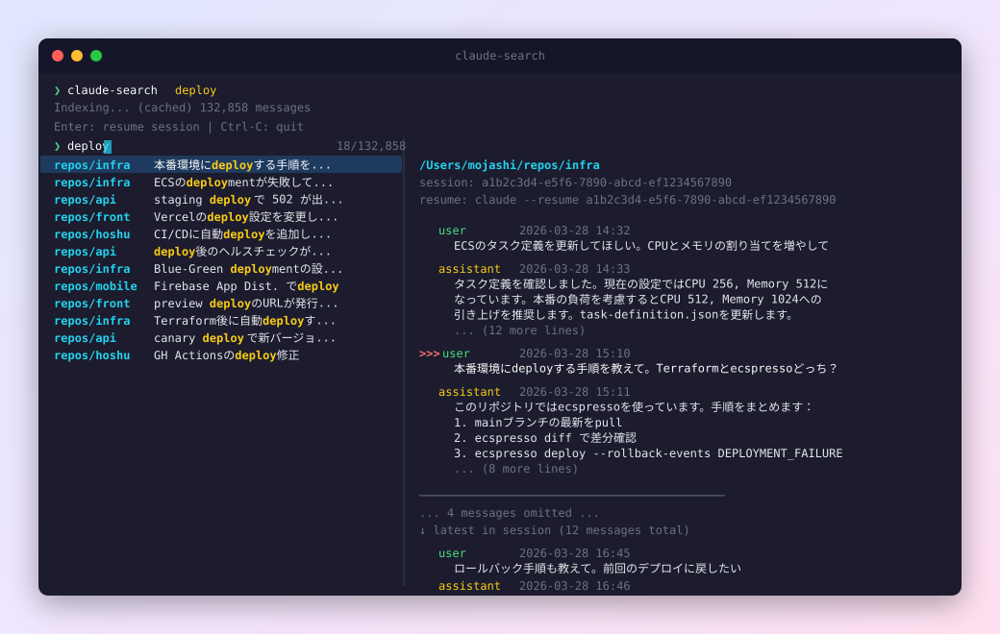

# claude-fulltext-search

Full-text search for [Claude Code](https://claude.ai/claude-code), [Codex](https://developers.openai.com/codex/cli), Antigravity (`agy`) and Kimi Code chat history with a full-screen picker — plus a shared index that other tools can query over HTTP.

## Install

```sh
curl -fsSL https://raw.githubusercontent.com/Mojashi/claude-fulltext-search/main/install.sh | sh
```



## Features

- Full-text search across Claude Code, Codex, Antigravity and Kimi Code sessions (including tool use / tool results)
- Substring matching that works for Japanese and other non-space-separated text (SQLite FTS5 trigram index); words are ANDed, `"quote"` a phrase
- Results ranked by relevance (whole words, phrases, who said it, how often, the session's first ask, recency); Ctrl-S for newest first
- Full-screen picker: every keystroke searches the index; the preview opens the session at the matched message, with every match marked
- Filter by project path, message role, or agent
- Resume sessions directly from search results (auto `cd` to the session's directory)
- Incremental indexing: only newly appended lines are read
- Optional daemon (`claude-search serve`) that keeps the index current and answers an HTTP API for other tools
- No dependencies; self-update from GitHub releases

Or specify a custom install directory:

```sh
INSTALL_DIR=~/.local/bin curl -fsSL https://raw.githubusercontent.com/Mojashi/claude-fulltext-search/main/install.sh | sh
```

### Build from source

Requires [Bun](https://bun.sh/).

```bash
git clone https://github.com/Mojashi/claude-fulltext-search.git
cd claude-fulltext-search
bun build --compile index.ts --outfile claude-search
mv claude-search ~/.local/bin/
```

### Update

```bash
claude-search --update
```

## Usage

```bash
# Search all conversations
claude-search

# Search with initial query
claude-search "docker compose"

# Filter by project directory (resolves path, includes subdirectories)
claude-search -p .
claude-search -p ~/repos/my-project

# Filter by role
claude-search -r user
claude-search -r assistant

# Filter by agent (claude|codex|agy|kimi|all, default: all)
claude-search -s codex

# Custom command on selection
claude-search -e 'echo {sessionId}'

# List all projects
claude-search --list-projects

# Configure settings (exec template, etc.)
claude-search --setup

# Remove the pre-1.0 JSON cache (~/.cache/claude-search/index.json)
claude-search --clear-cache
```

### Keys

| Key | |
|---|---|
| typing | search (each word must appear; `"two words"` for a phrase) |
| ↑ ↓ / Ctrl-P Ctrl-N, PgUp PgDn, wheel | move through results |
| Enter, or click the selected result | resume it |
| Shift-↑ ↓, Shift-PgUp PgDn, wheel over the preview | scroll the preview |
| Tab / Shift-Tab | next / previous matching message in the preview |
| Ctrl-S | best match ⇄ newest first |
| Ctrl-T | cycle agent: all, claude, codex, agy, kimi |
| Ctrl-O | only sessions under the current directory (or `-p`) |
| Ctrl-R | cycle who said it: anyone, user, assistant |
| Esc / Ctrl-C | quit |

Readline editing works in the query: Ctrl-A/E/B/F/U/K/W, Alt-Backspace.

## Index and daemon

All sessions go into one SQLite DB at `~/.cache/ai-session-index/index.db` (override with `AI_SESSION_INDEX_DB`).

- **Without a daemon**, `claude-search` brings the DB up to date itself before showing results.
- **With a daemon**, `claude-search` asks it over HTTP instead. The daemon re-indexes every 60s.

```bash
claude-search daemon install     # macOS: run `claude-search serve` as a LaunchAgent
claude-search daemon uninstall
claude-search serve --port 8095  # or run it under your own supervisor
```

HTTP API (`http://127.0.0.1:8095`, override clients with `AI_SESSION_INDEX_URL`):

| Endpoint | |
|---|---|
| `GET /health` | liveness |
| `GET /status?source=` | sessions / messages per agent, indexer state |
| `GET /search?q=&source=&project=&cwd=&role=&limit=200&sort=recent` | one hit per session; `sort=relevance` for best match first (with `score`) |
| `GET /sessions?source=&project=&cwd=&limit=30&offset=0` | latest sessions |
| `GET /projects?source=` | projects with session counts |
| `GET /session?source=&id=&project=` | full transcript, read fresh from disk |
| `GET /prefix?prefix=&source=` | most recent session whose id starts with prefix |
| `POST /reindex` | index now |

Command-line access for scripts: `claude-search search <query> --json`, `claude-search status --json`, `claude-search index --json`, `claude-search dedupe`.

## License

MIT
